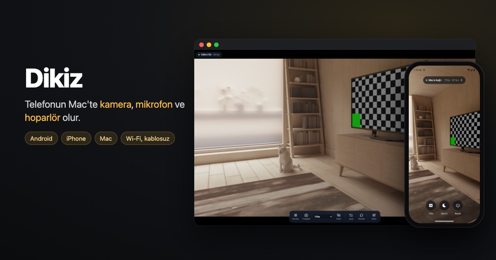
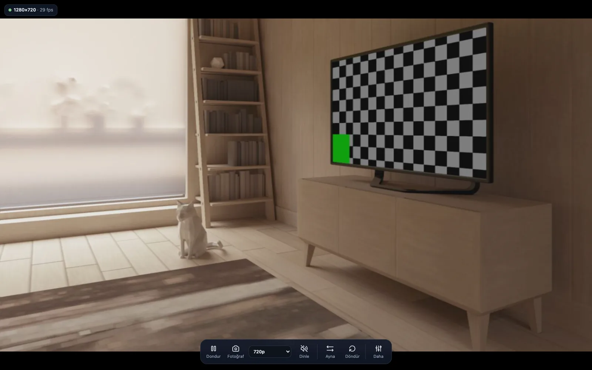
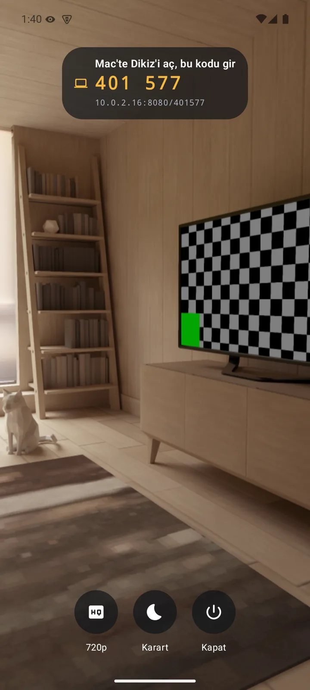

# Dikiz

**Telefonunu bilgisayarında kamera, mikrofon ve hoparlör olarak kullan.** Android ve iPhone ile çalışır, aynı Wi‑Fi yeter. Kablo, hesap ya da bulut yok; görüntü ve ses evinin ağından çıkmaz.



## Neler yapabilirsin

- **Telefon kamerasını Mac'te canlı izle.** Telefonu odanın bir köşesine koy, bilgisayardan izle. Bebek, evcil hayvan, kapı ya da masa üstü için.
- **Toplantıda web kamerası olarak kullan.** Zoom, Google Meet, Microsoft Teams ve FaceTime'da **Dikiz Kamera** olarak seçilir. Mac'in kamerası yoksa ya da kapağı kapalıysa işe yarar.
- **Telefonu mikrofon yap.** Telefonun sesini izleme ekranında dinle ya da toplantıda **Dikiz Mikrofon** olarak seç.
- **Bilgisayarın sesini telefondan çal.** Mac'in sesi telefon hoparlöründen çıkar.
- **Telefonun tüm kameraları:** 0.5× geniş açı, 1×, 2×, 3×; ön ve arka kamera, fener, odak.
- **İnternet yavaşsa kaliteyi düşür:** 1080p'den 144p'ye kadar. İstersen yalnızca ses.
- **Toplantı efektleri:** arka plan bulanıklığı, güzelleştirme ve filtreler. Hepsi cihazda, internete bir şey gitmez.
- **Güvenli eşleşme:** telefonda 6 haneli bir kod çıkar. Kodu bilmeyen kameranı açamaz; aynı ağda başka telefonlar olsa da karışmaz.

## Kurulum

### 1. Telefon

- **Android 8+:** [Releases](../../releases/latest) sayfasından `Dikiz.apk` dosyasını indir ve kur.
- **iPhone (iOS 17+):** TestFlight ile davetle dağıtılıyor. Kendin derlemek için aşağıdaki adımlara bak.

Uygulamayı aç; ekranın üstünde 6 haneli **eşleşme kodu** görünür.

### 2. Bilgisayar

**Hiçbir şey kurmadan:** telefonda yazan adresi (ör. `http://192.168.1.23:8080/482913`) aynı ağdaki herhangi bir bilgisayarın tarayıcısında aç. Windows, Linux ve Mac'te çalışır: canlı görüntü, dinleme, lens ve kalite seçimi, fotoğraf.

**Mac uygulaması (macOS 13+):** toplantı kamerası, toplantı mikrofonu, bilgisayar sesini telefona gönderme ve menü çubuğunda canlı önizleme için. `Dikiz.dmg` dosyasını aç, Dikiz'i **Uygulamalar** klasörüne sürükle, aç ve telefondaki kodu gir. Bir kez girmen yeter.

> Mac uygulaması bir sanal kamera ve ses sürücüsü içerdiği için Apple onaylı bir geliştirici imzası gerektirir. Hazır DMG şimdilik davetle paylaşılıyor; aşağıdaki adımlarla kendi Apple geliştirici hesabınla derleyebilirsin.

## Kullanım

1. Telefonda **Dikiz**'i aç.
2. Mac'te **Dikiz**'i aç; menü çubuğunda göz simgesi belirir ve telefondaki kodu sorar.
3. Göz simgesine bas: menünün üstünde küçük canlı önizleme var; tıklayınca büyük pencere açılır.
4. Toplantıda kamera olarak **Dikiz Kamera**'yı, mikrofon olarak **Dikiz Mikrofon**'u seç. Ses sürücüsü ilk kullanımda menüden bir kez kurulur (Mac şifresi ister).

| Ekran | |
|---|---|
|  |  |

### Kısayollar (izleme ekranı)

| Tuş | İşlev | Tuş | İşlev |
|---|---|---|---|
| `C` | Ön / arka kamera | `D` | Telefonu dinle |
| `Boşluk` | Dondur | `S` | Fotoğraf kaydet |
| `M` | Ayna | `R` | Döndür |
| `T` | Işık | `F` | Tam ekran |
| Tekerlek | Yakınlaştır | Tıkla | Odakla |

Çizgiler, simetri, ön ayna, sesli komut ve görünümler **Daha** menüsünde.

## Sık sorulanlar

**Telefonumu Mac'te web kamerası olarak nasıl kullanırım?**
Telefona Dikiz'i, Mac'e Dikiz uygulamasını kur, telefondaki kodu Mac'e gir. Zoom, Meet ya da Teams'te kamera olarak **Dikiz Kamera**'yı seç.

**İnternet gerekiyor mu?**
Hayır. Telefon ve bilgisayar aynı Wi‑Fi ağında olsun yeter; görüntü ve ses ağın dışına çıkmaz.

**Windows'ta çalışır mı?**
İzleme ekranı her tarayıcıda çalışır. Toplantı kamerası ve mikrofonu şimdilik yalnızca Mac'te.

**Telefon kilitlenince yayın durur mu?**
Android'de sürer. iPhone'da uygulama açık kalmalı; ekranı **Karart** ile kapatabilirsin.

## Kendin derle

**Android:** JDK 17+ ve Android SDK.

```bash
./gradlew assembleRelease
```

**Mac:** Xcode, [XcodeGen](https://github.com/yonaskolb/XcodeGen) ve sistem eklentisi imzalayabilen ücretli bir Apple geliştirici hesabı.

```bash
brew install xcodegen
DIKIZ_TEAM=<Apple ekip kimliğin> ./mac/build.sh        # Developer ID + Apple onayı → dist/Dikiz.dmg
DIKIZ_TEAM=<Apple ekip kimliğin> DIKIZ_DEV=1 ./mac/build.sh   # yalnızca kendi Mac'in için hızlı derleme
```

**iPhone:** Xcode ve XcodeGen.

```bash
cd ios && xcodegen generate && open Dikiz.xcodeproj
```

## Nasıl çalışır

Telefon görüntüyü Wi‑Fi'de MJPEG, sesi ham PCM olarak yayınlar ve kendini Bonjour ile duyurur. İlanda yalnızca rastgele bir kimlik var; telefonun adı ve tüm görüntü, ses yolları eşleşme koduyla korunur. Mac uygulaması eşleştiği telefonu bulur ve `127.0.0.1` üzerinden tarayıcıya, sanal kameraya ve ses sürücüsüne aktarır.

```
app/        Android uygulaması (Kotlin, CameraX, Jetpack Compose)
ios/        iPhone uygulaması (SwiftUI, AVFoundation)
mac/        menü çubuğu uygulaması (Swift)
mac/camera  Dikiz Kamera: CoreMediaIO sanal kamera eklentisi
mac/audio   Dikiz Mikrofon ve Dikiz Hoparlör: Core Audio sürücüsü
app/src/main/assets/index.html  izleme ekranı (tek HTML dosyası)
```

## Teşekkürler

İkonlar: [Tabler Icons](https://github.com/tabler/tabler-icons) (MIT)
